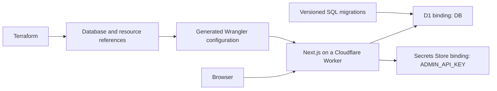

# Fieldwork · Cloudflare D1 showcase

A working Next.js application on **Cloudflare Workers**, with **D1**, **Secrets Store**, **Terraform**, and **pnpm**. Its small checkpoint ledger exercises database reads, authenticated writes, migrations, and secret retrieval across local, dev, staging, and production.

The purpose is to make the path from your laptop to production testable. A successful `next dev` session alone does not establish production compatibility.

## Start locally

Use Node.js 24 LTS and the pnpm version pinned in `package.json`. Terraform 1.14.1 is used by CI; you don't need Terraform or a Cloudflare account for the application locally.

```sh
corepack enable
pnpm install --frozen-lockfile
pnpm setup:local
pnpm dev
```

Open <http://localhost:3000>. Enter **`local-showcase-only`** in the write API key field. Create a checkpoint, reload, mark it verified, and delete it. The list is server-rendered and persisted through the D1 binding.

`setup:local` applies migrations, adds synthetic fixtures, and initializes the local Secrets Store. It is safe to repeat and preserves an existing local key. Local state lives in the ignored `.wrangler/state` directory. No cloud resources are contacted by setup.

To test the production build in the Workers runtime:

```sh
pnpm build:worker
pnpm preview
# http://localhost:8787
```

Stop preview before running `pnpm test:e2e`; the tests start their own server on port 8787.

## How the environments fit together

| Mode                | Application runtime           | Database            | API key             |
| ------------------- | ----------------------------- | ------------------- | ------------------- |
| `pnpm dev`          | Next.js dev server, Node.js   | Local D1 simulation | Local Secrets Store |
| `pnpm preview`      | Built Worker, local `workerd` | Local D1 simulation | Local Secrets Store |
| `pnpm dev:remote`   | Next.js dev server, Node.js   | **Real dev D1**     | Local Secrets Store |
| Deployed dev        | Cloudflare Workers            | Dev D1              | Dev secret          |
| Deployed staging    | Cloudflare Workers            | Staging D1          | Staging secret      |
| Deployed production | Cloudflare Workers            | Production D1       | Production secret   |

Every mode uses the same D1 API, application queries, SQL migrations, and asynchronous secret-binding API. Each cloud environment gets a separate Worker, database, secret name, Terraform backend key, and GitHub environment.



Cloudflare's local tooling runs Workers in `workerd`, but the hosted database, network, permissions, limits, and secret service still require cloud verification. See [the workflow and its remaining gaps](docs/workflow.md). [Cloudflare local development documentation](https://developers.cloudflare.com/workers/local-development/).

## CI/CD

Pull requests run lint, TypeScript, configuration guards, a migration upgrade test, Terraform validation/tests, and browser/API tests against the **built Worker with actual local bindings**.

- Push to `develop`: validate → deploy dev → check real D1 and the deployed app.
- Push to `main`: validate once → deploy staging → smoke checks → production environment approval → deploy the **same build artifact** → smoke checks.
- A production failure never triggers an automatic database rollback.
- Cloud deployments are opt-in through `CLOUDFLARE_DEPLOY_ENABLED=true`; validation works immediately on a fresh clone or fork without credentials.

See [deployment and credential setup](docs/deployment.md), [database changes and recovery](docs/migrations.md), and [secret ownership and rotation](docs/secrets.md).

## Ownership

| Tool                     | Owns                                                                                 |
| ------------------------ | ------------------------------------------------------------------------------------ |
| Terraform                | D1 databases, environment naming, resource-reference outputs, destruction protection |
| Wrangler / OpenNext      | Compiled Worker, static assets, bindings, version deployment                         |
| Wrangler D1 migrations   | Ordered SQL schema changes and migration history                                     |
| Cloudflare Secrets Store | API key values and rotation                                                          |
| GitHub Actions           | Validation, serialized deployments, artifact promotion                               |
| Private R2 bucket        | Terraform state and state lock objects                                               |

Terraform does not contain `local-exec` deployment hooks or secret-value variables. Terraform and Wrangler do not both manage the Worker. This avoids competing ownership and prevents the API key from entering Terraform state.

## Verify

```sh
pnpm check
pnpm setup:local
pnpm build:worker
pnpm exec playwright install chromium
pnpm test:e2e
terraform -chdir=infra init -backend=false -input=false
terraform -chdir=infra fmt -check -recursive
terraform -chdir=infra validate
terraform -chdir=infra test
```

The migration test upgrades an existing v1 database, checks its data survives, repeats migration application, and exercises an old-style insert against the new schema. API tests cover create/read/update/delete, missing/wrong keys, malformed/oversized input, cross-origin writes, and literal SQL-looking input. Browser tests cover persistence across reloads and a narrow layout.

## Project map

```text
src/app/                 Next.js page and HTTP route handlers
src/components/          Interactive checkpoint ledger
src/lib/                 D1 queries, health checks, write authorization
migrations/              Shared append-only SQL history
seeds/                   Synthetic local fixtures only
infra/                   Terraform root and environment tests
scripts/                 Local setup, config generation, deployment, smoke checks
tests/                   Configuration, migration, and Worker/browser tests
.github/workflows/       Build once; validate and promote
docs/                    Environment, deployment, secret, and migration guides
```

## Framework choice

This project uses **Next.js itself plus the OpenNext Cloudflare adapter**, including the standard `next dev` workflow. Cloudflare currently recommends vinext for new Next.js-compatible Workers applications; vinext reimplements the Next.js API surface on Vite. This showcase intentionally keeps the actual Next.js runtime to demonstrate the development/production gap and how to test it. [Cloudflare's Next.js deployment paths](https://developers.cloudflare.com/workers/framework-guides/web-apps/nextjs/), [OpenNext adapter setup](https://opennext.js.org/cloudflare/get-started).

The data routes are dynamic. ISR, image optimization, custom domains, per-PR databases, user accounts, and production authentication are deliberately outside this small showcase. The shared write key is an operator demo, not a user identity system. Reads are public; use synthetic data.
